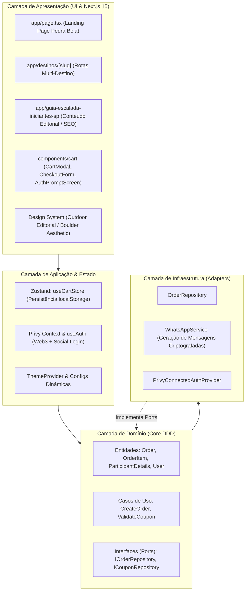
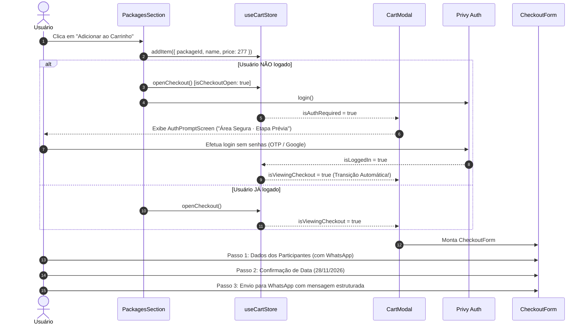

# 🏛️ Arquitetura do XperienceClimb

## 1. Visão Geral do Sistema

O **XperienceClimb** é uma plataforma full-stack moderna de reservas e imersão para experiências de escalada em rocha natural, com foco no polo de **Pedra Bela (SP)** e suporte nativo a múltiplos destinos de montanhismo (como a Floresta Nacional de Ipanema).

O projeto é construído sobre o **Next.js 15 (App Router)** e fundamentado nos princípios de **Clean Architecture** e **Domain-Driven Design (DDD)**, garantindo que as regras de negócio centrais permaneçam isoladas de detalhes de infraestrutura, SDKs externos e bibliotecas de apresentação.



---

## 2. Tecnologias Principais

| Categoria                | Tecnologia        | Versão / Padrão               | Responsabilidade                                                       |
| :----------------------- | :---------------- | :---------------------------- | :--------------------------------------------------------------------- |
| **Framework Web**        | Next.js           | 15.x (App Router)             | Renderização híbrida (SSG + SSR), API routes e compilação otimizada    |
| **Linguagem**            | TypeScript        | 5.x (Strict Mode)             | Tipagem estática rigorosa de ponta a ponta                             |
| **Estilização**          | Tailwind CSS      | 3.4.x                         | Design tokens semânticos, micro-interações e responsividade            |
| **Identidade Visual**    | Boulder Aesthetic | Arc'teryx & Outdoor Editorial | Contraste tipográfico (Mono técnico + Display preto + Itálico poético) |
| **Estado Global**        | Zustand           | 5.x                           | Carrinho reativo com persistência automática em `localStorage`         |
| **Autenticação**         | Privy SDK         | React Auth 3.x                | Login híbrido sem senhas (E-mail OTP, Google, Social e Web3)           |
| **Checkout & Conversão** | WhatsApp API      | Direct Intent Integration     | Geração de payload detalhado para confirmação de apólice e pagamento   |
| **Testes Automatizados** | Jest + RTL        | 24 Suítes / 269 Testes        | Testes unitários, de componentes, fluxos de checkout e integração      |
| **Iconografia**          | Lucide React      | `strokeWidth={1.5}`           | Ícones técnicos padronizados com traço elegante                        |

---

## 3. Estrutura de Diretórios e Camadas

```
XperienceClimb/
├── src/
│   ├── app/                                 # Presentation Layer: Next.js App Router
│   │   ├── api/                            # API Routes (/api/packages, /api/chat, /api/tours)
│   │   ├── destinos/[slug]/                # Roteamento dinâmico multi-destino
│   │   ├── guia-escalada-iniciantes-sp/    # Página editorial de SEO & autoridade
│   │   ├── politica-de-privacidade/        # Conformidade legal LGPD
│   │   ├── termos-de-uso/                  # Termos contratuais de aventura
│   │   ├── layout.tsx                      # Layout raiz com Provedores globais
│   │   └── page.tsx                        # Landing Page principal (Pedra Bela)
│   ├── components/                         # Componentes React Reutilizáveis
│   │   ├── auth/                           # Guardas de autenticação (AuthGuard)
│   │   ├── cart/                           # Carrinho, AuthPromptScreen e CheckoutForm
│   │   ├── layout/                         # Navegação fixa (Navigation)
│   │   ├── providers/                      # PrivyProvider e PrivyConnectedAuthProvider
│   │   ├── sections/                       # Seções da página (Hero, Packages, Gallery, About)
│   │   └── ui/                             # Botões, Cards, Doodles e tokens base
│   ├── core/                               # Domain Layer (Puro, sem dependências de UI)
│   │   ├── entities/                       # Order, User, Coupon, Tour
│   │   ├── repositories/                   # Interfaces (IOrderRepository, IUserRepository)
│   │   ├── services/                       # Interfaces de serviços de domínio
│   │   └── use-cases/                      # CreateOrder, ValidateCoupon, etc.
│   ├── hooks/                              # Custom React Hooks (useAuth, etc.)
│   ├── infrastructure/                     # Infrastructure Layer
│   │   ├── repositories/                   # OrderRepository (persistência e mapeamento)
│   │   └── services/                       # WhatsAppService, CouponService
│   ├── lib/                                # Utilitários compartilhados, constantes e datas
│   ├── store/                              # Gerenciamento de estado global (useCartStore)
│   ├── styles/                             # globals.css e tokens do Tailwind
│   └── themes/                             # Motor dinâmico de temas (pedra-bela.ts, etc.)
├── docs/                                   # Documentação técnica e estratégica
│   ├── FLUXOS_E_DIAGRAMAS.md               # Compêndio de diagramas Mermaid
│   └── GLOSSARIO_TECNICO_SEGURANCA.md      # Glossário de termos técnicos de rocha
├── public/                                 # Assets públicos (imagens de rocha, ícones SVG)
├── CHANGELOG.md                            # Histórico semântico de versões
└── Package_Form.md                         # Documentação do formulário de checkout
```

---

## 4. Design System & Princípios de Interface (Boulder Aesthetic)

Inspirado na alta alfaiataria de montanha (marcas como Arc'teryx e Black Diamond), o sistema adota regras rigorosas documentadas em `.agents/rules/AGENTS.md`:

1. **Tipografia de Alto Contraste:**
   - **Títulos:** `font-display` com peso ultra-bold (`font-black`), caixa alta e rastreamento justo (`tracking-tight`).
   - **Acentos Poéticos:** `font-serifIt` em itálico serifado leve para criar contraste humano.
   - **Metadados Técnicos:** `font-mono` em tamanho reduzido (`text-xs` / `text-[10px]`) e caixa alta com espaçamento ampliado (`tracking-widest`), remetendo a guias de campo e equipamentos de alta precisão (ex: `CAP · 01 / BATISMO`, `ALT 1.120M`, `GPS 22°42'S`).
2. **Paleta de Cores da Rocha:**
   - Fundo de papel claro: Sand (`#FAFAF7`, `bg-sand-50`).
   - Escuro profundo de granito: Forest Ink (`#0F1116`, `#1B2421`, `bg-forest-900`).
   - Realces de Aventura: Terracotta / Magma (`#E0533C`, `#FF4D2B`) e Dourado Solar (`#FFD700`, `text-sun-500`).
3. **Micro-interações:**
   - Elevação suave nos cards ao pairar (`hover:-translate-y-1.5 hover:shadow-hover transition-all duration-300 ease-out`).
   - Ícones com traço técnico fino (`strokeWidth={1.5}`).

---

## 5. Fluxo de Autenticação Prévia & Reserva Segura



---

## 6. Convenção Monetária & Cálculo de Preços

Para evitar discrepâncias numéricas e arredondamentos indesejados, o sistema opera sob a seguinte regra:

1. **Camada Visual e Carrinho (Zustand):**
   - O preço é armazenado e trafegado em **Reais brutos** (`number`, ex: `277`).
   - A exibição utiliza [`formatPrice(price)`](src/lib/utils.ts) com `Intl.NumberFormat('pt-BR', { style: 'currency', currency: 'BRL' })`, formatando `277` como **`R$ 277,00`**.
2. **Camada de Domínio e Casos de Uso ([`CreateOrder.ts`](src/core/use-cases/orders/CreateOrder.ts)):**
   - Ao processar pedidos, o caso de uso multiplica o valor por 100 (`item.price * item.quantity * 100`), convertendo Reais para **centavos inteiros** (`27700`).
   - Garante compatibilidade com gateways e persistência financeira sem imprecisões de ponto flutuante.

---

## 7. Garantia de Qualidade e Testes Automatizados

O repositório é protegido por verificações automáticas com hooks de pré-commit via **Husky**:

```bash
# 1. Checagem de Tipagem Estática
npm run type-check   # tsc --noEmit (0 erros)

# 2. Execução da Suíte Completa de Testes
npm test             # 24/24 suítes aprovadas, 269/269 testes passando

# 3. Build de Produção do Next.js
npm run build        # Compilação estática de 19 rotas com sucesso
```
