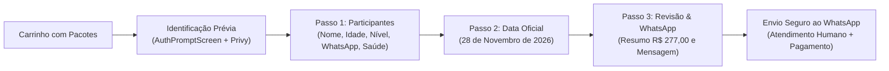

# 📋 Documentação do Fluxo de Checkout & Formulário de Reserva

Este documento detalha o funcionamento, regras de validação e arquitetura do processo de reserva de expedições da **XperienceClimb**, implementado em [`src/components/cart/CheckoutForm.tsx`](src/components/cart/CheckoutForm.tsx) e protegido pela tela de identificação prévia em [`src/components/cart/CartModal.tsx`](src/components/cart/CartModal.tsx).

---

## 1. Visão Geral do Fluxo

O processo de finalização de compra foi arquitetado para ser **direto, acolhedor e seguro**. Ele garante que todas as exigências legais e técnicas de segurança em rocha (emissão da apólice nominal do Seguro Aventura, identificação de contato de emergência e nível de aptidão) sejam coletadas com agilidade.

---

## 2. Autenticação Prévia Obrigatória (`AuthPromptScreen`)

Para eliminar o atrito de preencher todo o formulário para apenas no final receber um bloqueio de sessão expirada, o sistema implementa uma barreira de segurança prévia:

1. **Quando é acionada:** Sempre que um visitante anônimo ou usuário deslogado clicar em _"Adicionar ao Carrinho"_ ou tentar finalizar a compra.
2. **Interface Amigável:** Renderiza a tela `AuthPromptScreen` com o selo `ÁREA SEGURA · ETAPA PRÉVIA`.
3. **Explicação de Valor:** Informa ao cliente que a identificação é necessária para vincular a apólice individual do Seguro Aventura e garantir a vaga na via.
4. **Resumo Financeiro:** Apresenta o subtotal em tempo real do pedido (`Total a Pagar: R$ 277,00`).
5. **Transição Automática:** Assim que o login no Privy é concluído, o modal detecta a sessão ativa e avança instantaneamente para o formulário de participantes, sem recarregar a página.

---

## 3. Conceito Central: "1 Pacote = 1 Participante"

O sistema adota a premissa de que cada vaga em expedição de escalada exige dados individuais para fins de segurança e apólice de seguro:

- **2x Pacote AGARRÃO:** Renderiza 2 blocos de campos na Etapa 1, exigindo o preenchimento dos dados de cada pessoa.
- **1x Pacote AGARRÃO + 1x Pacote CRUX:** Renderiza formulários específicos para cada modalidade e participante.

---

## 4. Etapas Detalhadas do Formulário

### Etapa 1: Dados dos Participantes (`ParticipantDetailsStep`)

**Objetivo:** Coletar dados pessoais e de aptidão física para planejamento técnico dos instrutores e emissão de apólice.

| Campo                    | Tipo / Controle          | Validação / Regras               | Observações                                                                                    |
| :----------------------- | :----------------------- | :------------------------------- | :--------------------------------------------------------------------------------------------- |
| **Nome Completo**        | `input[type="text"]`     | Obrigatório                      | Nome civil completo para seguro                                                                |
| **Idade**                | `input[type="number"]`   | Obrigatório (12 a 99 anos)       | Menores de 18 anos exigem autorização de responsável                                           |
| **Nível de Experiência** | `select`                 | Obrigatório                      | Opções: `Minha primeira vez`, `Iniciante`, `Intermediário`, `Avançado`                         |
| **WhatsApp**             | `input[type="text"]`     | Obrigatório (11 dígitos com DDD) | Formatação automática com máscara: `(11) 99999-9999`                                           |
| **Declaração de Saúde**  | `input[type="checkbox"]` | Obrigatório (`true`)             | Termo: _"Declaro estar em boas condições físicas e de saúde para praticar escalada esportiva"_ |

> **Validação de Avanço:** O botão _"Confirmar Dados e Continuar"_ permanece desabilitado até que todos os campos obrigatórios de todos os participantes estejam estritamente válidos.

---

### Etapa 2: Confirmação de Data e Detalhes (`ClimbingDetailsStep`)

**Objetivo:** Alinhar o agendamento da expedição com o participante e coletar observações ou necessidades específicas.

- **Data da Escalada (Somente Leitura):** Fixada na data oficial da próxima expedição confirmada:
  - **Data:** **28 de Novembro de 2026** (configurada em [`src/lib/constants.ts`](src/lib/constants.ts)).
- **Solicitações Especiais (Opcional):**
  - Campo de texto livre para restrições alimentares (almoço do restaurante incluso no pacote), necessidades de transporte ou limitações físicas.
- **Avisos Informativos:**
  - Atividade sujeita às condições climáticas seguras da rocha.
  - Equipamentos de segurança certificados (UIAA) inclusos.
  - Idade mínima de 12 anos.

---

### Etapa 3: Revisão e Envio ao WhatsApp (`ConfirmationStep`)

**Objetivo:** Transparência total antes do envio e prévia fiel da mensagem estruturada.

1. **Resumo do Pedido:**
   - Nome do pacote e nome do participante.
   - Valor individual formatado em Reais (`R$ 277,00`).
   - Valor total final do pedido calculado corretamente.
2. **Data e Local:**
   - Exibição por extenso da data confirmada (`sábado, 28 de novembro de 2026`).
3. **Preview da Mensagem do WhatsApp:**
   - Exibição de um bloco monospace simulando a mensagem exata que será enviada à equipe da XperienceClimb, contendo ID único da transação, dados do cliente e participantes.
4. **Botão Final de Ação:**
   - `"📱 Enviar para WhatsApp e Finalizar"`: Chama o caso de uso [`CreateOrder`](src/core/use-cases/orders/CreateOrder.ts), salva o registro no repositório local e dispara a abertura do WhatsApp com a URL codificada.

---

## 5. Resolução de Erros e Casos de Borda

1. **Sessão Expirada no Envio:**
   - Em vez de disparar `alert()`, o botão final aciona a rotina segura `login()` do Privy.
2. **Conexão Offline ou Queda:**
   - O estado do carrinho permanece salvo em `localStorage` através do middleware de persistência do Zustand. Ao recarregar a página, os itens adicionados continuam disponíveis.
3. **Solicitação de Datas Diferentes:**
   - Se o cliente não puder participar na data de 28 de Novembro de 2026, a interface oferece botão direto de WhatsApp na seção de pacotes para agendamento privativo sob medida.
