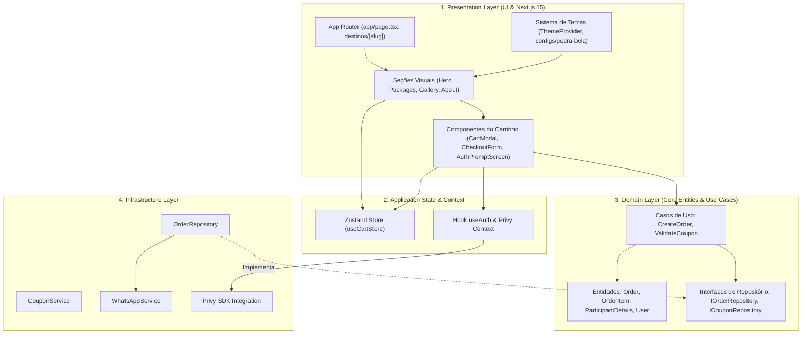
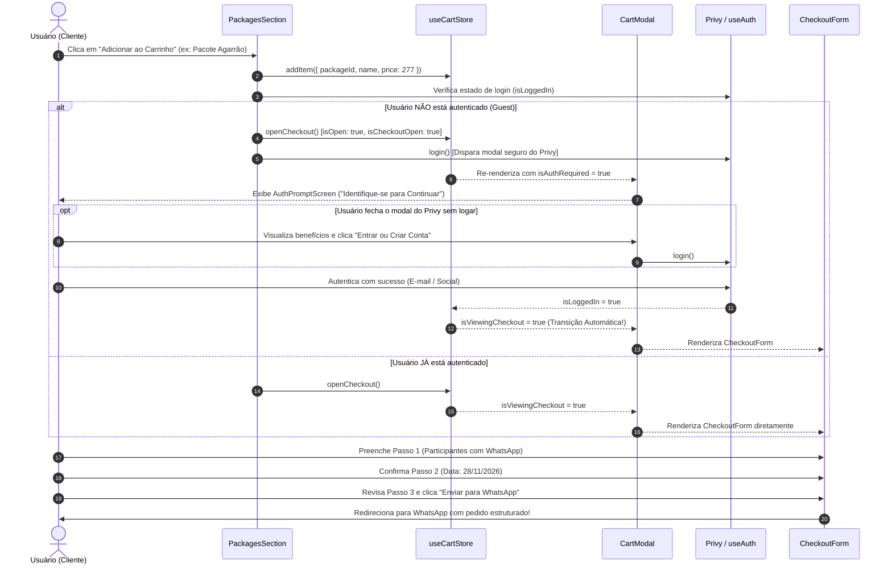
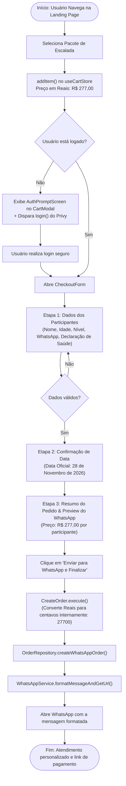
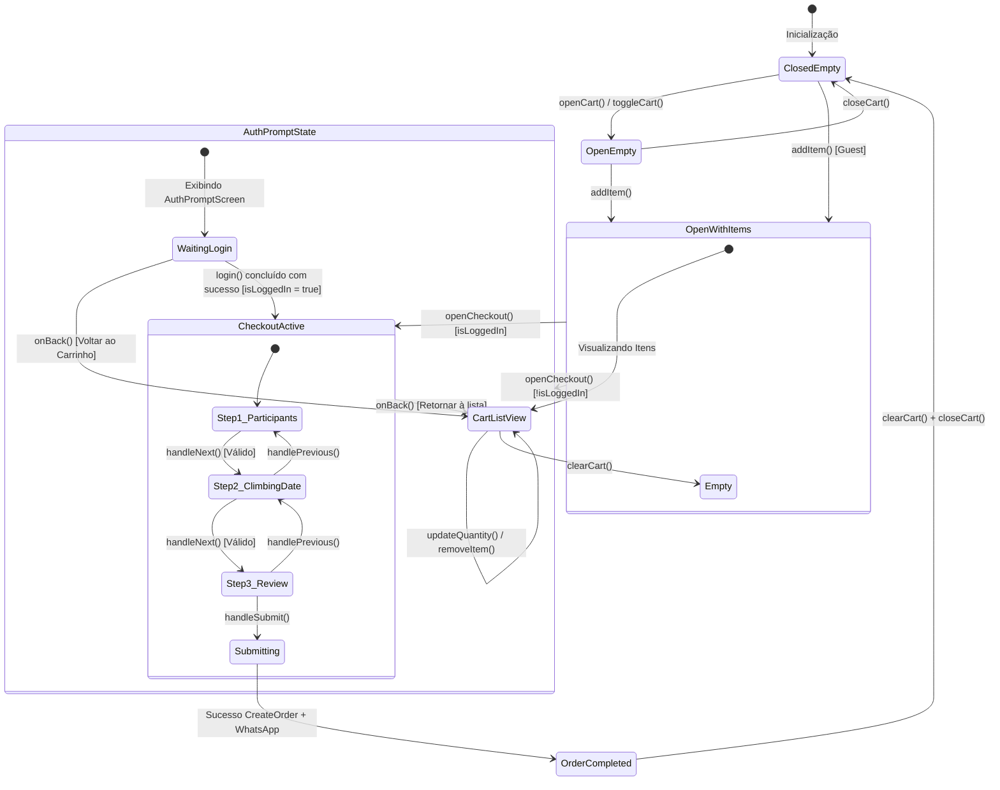
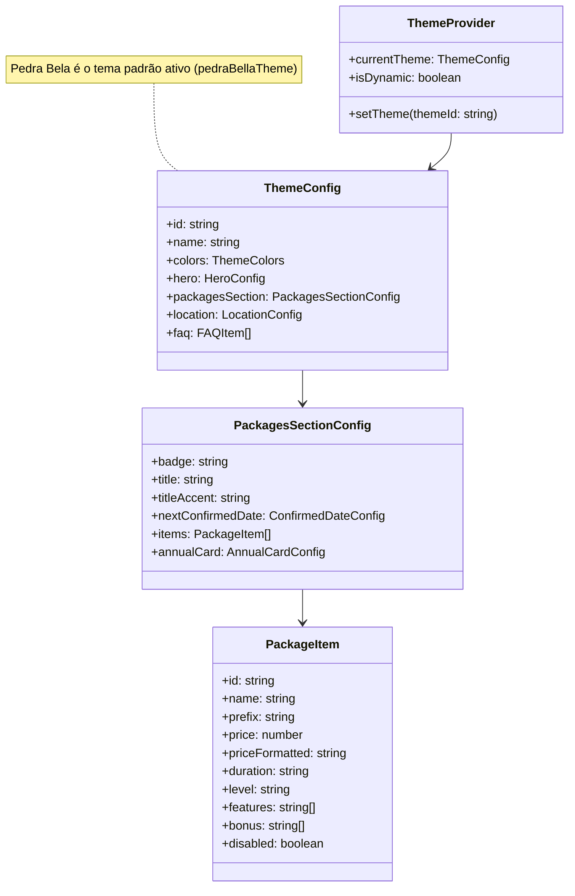

# 🗺️ Diagramas de Arquitetura e Fluxos Técnicos — XperienceClimb

Este documento consolida a modelagem visual, fluxos de dados e diagramas arquiteturais do sistema **XperienceClimb**, facilitando a compreensão para engenheiros, designers e stakeholders.

---

## 1. Arquitetura em Camadas (Clean Architecture + DDD)

A aplicação segue a separação estrita de responsabilidades inspirada nos princípios da **Clean Architecture**, onde o domínio central independe de bibliotecas externas, frameworks e provedores de banco de dados ou interfaces.

---

## 2. Diagrama de Sequência: Autenticação Prévia Obrigatória ao Checkout

Este fluxo ilustra o comportamento introduzido para assegurar que apenas usuários devidamente identificados preencham os 3 passos do formulário de reserva, eliminando bloqueios tardios.

---

## 3. Diagrama de Fluxo de Reserva & Geração de Pedido

Mapeamento da jornada de dados desde a escolha de itens até o envio da mensagem criptografada ao atendente da expedição.

---

## 4. Máquina de Estados do Carrinho (`useCartStore`)

O estado global do carrinho é gerenciado pelo **Zustand** com persistência em `localStorage`.

---

## 5. Arquitetura do Sistema de Temas e Multi-Destinos

O XperienceClimb foi concebido para ser agnóstico quanto ao destino de aventura, permitindo alternar marcas, paletas de cores e catálogos dinamicamente.

---

## 6. Convenção de Preços e Moeda no Sistema

| Camada / Componente                                                               | Formato                | Exemplo                              | Responsabilidade                                                 |
| :-------------------------------------------------------------------------------- | :--------------------- | :----------------------------------- | :--------------------------------------------------------------- |
| **Theme Configs** ([`pedra-bela.ts`](../src/themes/configs/pedra-bela.ts))        | `number` (Reais)       | `277`                                | Preço nominal de venda cadastrado                                |
| **Zustand Store** ([`useCartStore.ts`](../src/store/useCartStore.ts))             | `number` (Reais)       | `277`                                | Armazenamento do item no carrinho                                |
| **Formatação UI** ([`src/lib/utils.ts`](../src/lib/utils.ts))                     | `string` (BRL)         | `R$ 277,00`                          | Exibição internacionalizada `Intl.NumberFormat`                  |
| **Caso de Uso** ([`CreateOrder.ts`](../src/core/use-cases/orders/CreateOrder.ts)) | `number` (Centavos)    | `27700`                              | Cálculo matemático preciso sem arredondamento de ponto flutuante |
| **Entidade de Pedido** ([`Order.ts`](../src/core/entities/Order.ts))              | `{ amount, currency }` | `{ amount: 27700, currency: 'BRL' }` | Persistência e regras de domínio financeiro                      |
