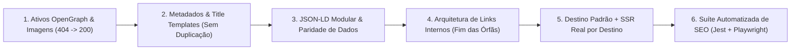

# 🛠️ Plano de Implementação: Correção Completa de SEO, Destino Padrão & Testes Automatizados (`XperienceClimb`)

- **Projeto:** Xperience Climb (`https://climb.xperiencehubs.com`)
- **Data:** 24 de Outubro de 2026
- **Status:** ✅ **CONCLUÍDO E VALIDADO (271 testes unitários Jest + 3 suítes E2E Playwright passando)**
- **Documentos de Referência:**
  - [AUDITORIA_FREE_SEO_LOCAL.md](file:///Users/govinda/projetos/XperienceClimb/seo/AUDITORIA_FREE_SEO_LOCAL.md)
  - [TECNICAS_AVANCADAS_VALIDACAO_SEO.md](file:///Users/govinda/projetos/XperienceClimb/seo/TECNICAS_AVANCADAS_VALIDACAO_SEO.md)

---

## 🎯 Objetivo

Corrigir integralmente os **6 problemas técnicos, semânticos e de arquitetura de SEO** identificados na auditoria local, garantir o **destino padrão (`Pedra Bela`)** em `/` e `/destinos` sem erros `404`, e implementar a **suíte automatizada de validação avançada de SEO** utilizando **Jest** e **Playwright** com custo zero.

---

## ✅ Alterações Implementadas

### Etapa 1: Ativos OpenGraph `1200x630px` & Padronização de Mídia (`public/images/`)

- Criadas as imagens OpenGraph físicas (`1200x630px`, `< 300 KB`):
  - `public/images/site-og.jpg`
  - `public/images/themes/pedra-bela/og-image.jpg`
  - `public/images/themes/fazenda-ipanema/og-image.jpg`
- Sincronizados todos os caminhos de imagens e vídeos nos temas [pedra-bela.ts](file:///Users/govinda/projetos/XperienceClimb/src/themes/configs/pedra-bela.ts), [fazenda-ipanema.ts](file:///Users/govinda/projetos/XperienceClimb/src/themes/configs/fazenda-ipanema.ts) e [guia-escalada-iniciantes-sp/page.tsx](file:///Users/govinda/projetos/XperienceClimb/src/app/guia-escalada-iniciantes-sp/page.tsx).

### Etapa 2: Destino Padrão em `/`, `/destinos` e `/destinos/[slug]`

- **Raiz `/` ([page.tsx](file:///Users/govinda/projetos/XperienceClimb/src/app/page.tsx)):** Carrega `pedra-bela` como destino padrão com `HTTP 200`.
- **Rota `/destinos` ([destinos/page.tsx](file:///Users/govinda/projetos/XperienceClimb/src/app/destinos/page.tsx)):** Redireciona automaticamente para `/destinos/pedra-bela`.
- **Rota `/destinos/[slug]` ([destinos/[slug]/page.tsx](file:///Users/govinda/projetos/XperienceClimb/src/app/destinos/[slug]/page.tsx)):** Redireciona qualquer slug desconhecido para `/destinos/pedra-bela` em vez de retornar 404.

### Etapa 3: Metadados, `<title>` Único e Eliminação de Sufixos Duplicados

- Removida a repetição `| Xperience Climb | Xperience Climb` em [destinos/[slug]/page.tsx](file:///Users/govinda/projetos/XperienceClimb/src/app/destinos/[slug]/page.tsx), [guia-escalada-iniciantes-sp/page.tsx](file:///Users/govinda/projetos/XperienceClimb/src/app/guia-escalada-iniciantes-sp/page.tsx), [checkout/layout.tsx](file:///Users/govinda/projetos/XperienceClimb/src/app/checkout/layout.tsx) e [test-e2e/layout.tsx](file:///Users/govinda/projetos/XperienceClimb/src/app/test-e2e/layout.tsx).
- Consolidada a canonical de `/destinos/pedra-bela` para `https://climb.xperiencehubs.com`, enquanto `/destinos/fazenda-ipanema` mantém canonical própria.

### Etapa 4: Dados Estruturados (`Schema.org` JSON-LD) Sem Colisão

- Modularizado [StructuredData.tsx](file:///Users/govinda/projetos/XperienceClimb/src/components/seo/StructuredData.tsx) com `mode="global"` e `mode="home"`, garantindo no máximo 1 `FAQPage` por rota.
- Corrigidas as âncoras de `SiteNavigationElement` (`/#lugar`, `/#batismo`), horário operacional (`08:30`–`18:00`) e idade mínima (`12 anos`).

### Etapa 5: Renderização SSR Real por Destino (`Fazenda Ipanema`) e Links Internos

- Adicionado suporte a `initialThemeId` no [ThemeProvider.tsx](file:///Users/govinda/projetos/XperienceClimb/src/themes/ThemeProvider.tsx) para renderizar o conteúdo exclusivo da **Fazenda Ipanema (FLONA Iperó - SP)** direto no HTML do servidor (SSR Wave 1).
- Adicionados links internos diretos para `/guia-escalada-iniciantes-sp`, `/destinos/pedra-bela` e `/destinos/fazenda-ipanema` em [BeginnerSection.tsx](file:///Users/govinda/projetos/XperienceClimb/src/components/sections/BeginnerSection.tsx), [CommunitySection.tsx](file:///Users/govinda/projetos/XperienceClimb/src/components/sections/CommunitySection.tsx) e no `Footer`.

### Etapa 6: Suíte Automatizada de Validação Avançada de SEO

- **Jest Unit Contracts:** [seo-contracts.test.tsx](file:///Users/govinda/projetos/XperienceClimb/src/components/seo/__tests__/seo-contracts.test.tsx)
- **Playwright E2E SEO Graph & Jaccard Similarity:** [seo-graph.spec.ts](file:///Users/govinda/projetos/XperienceClimb/tests/e2e/seo-graph.spec.ts)
