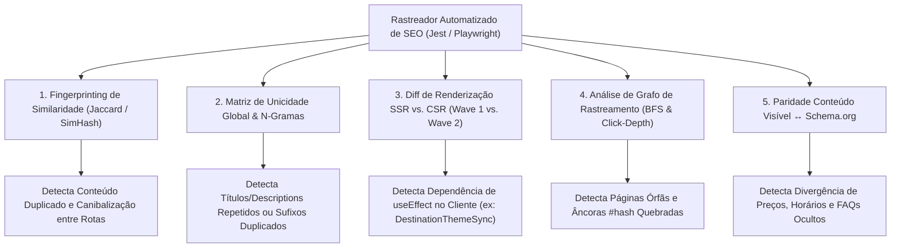

# 🧠 Técnicas Avançadas de Validação e Testes Automatizados de SEO

- **Projeto:** Xperience Climb (`https://climb.xperiencehubs.com`)
- **Data:** 24 de Outubro de 2026
- **Objetivo:** Documentar a arquitetura de testes automatizados de SEO (Jest + Playwright) e as 5 técnicas avançadas de engenharia de SEO (_Technical & Programmatic SEO_) para detectar duplicação, canibalização, páginas órfãs e falhas de renderização SSR antes do deploy.

---

## 🏗️ Parte 1: Arquitetura de Testes Automatizados em 2 Camadas

O repositório da **Xperience Climb** já possui em [`package.json`](file:///Users/govinda/projetos/XperienceClimb/package.json#L10-L23) toda a stack necessária (**Jest** + **Playwright**) para validar o SEO automaticamente a cada commit e no pipeline de CI/CD.

### Camada 1: Testes Unitários de Contrato SEO com Jest (`npm run test:unit`)

Roda em menos de 1 segundo (ideal para o hook `pre-commit` do Husky) sem precisar subir servidor HTTP, validando diretamente os módulos TypeScript e o sistema de arquivos:

1. **Contrato de Metadados ([`layout.tsx`](file:///Users/govinda/projetos/XperienceClimb/src/app/layout.tsx), [`page.tsx`](file:///Users/govinda/projetos/XperienceClimb/src/app/page.tsx), `generateMetadata`):**
   - Garante que o `<title>` final tenha entre **30 e 60 caracteres**.
   - Detecta duplicação de sufixo de marca (ex.: `| Xperience Climb | Xperience Climb`) causada pela combinação de `title.template` com títulos estáticos nas subpáginas.
   - Garante que `description` tenha entre **120 e 160 caracteres**.
   - Verifica se `alternates.canonical` usa HTTPS, aponta para `https://climb.xperiencehubs.com` e não contém barras duplicadas.
2. **Verificação Física de Ativos OpenGraph e Schema (`fs.existsSync`):**
   - Extrai todos os caminhos de imagens declarados em `openGraph.images`, `twitter.images` e [`StructuredData.tsx`](file:///Users/govinda/projetos/XperienceClimb/src/components/seo/StructuredData.tsx) e valida se cada arquivo existe fisicamente dentro de `public/` (impedindo erros `404` em miniaturas de WhatsApp, Instagram, LinkedIn e X).
3. **Consistência entre [`sitemap.ts`](file:///Users/govinda/projetos/XperienceClimb/src/app/sitemap.ts) e [`robots.ts`](file:///Users/govinda/projetos/XperienceClimb/src/app/robots.ts):**
   - Garante que todas as páginas públicas válidas constam no `sitemap.ts` com `lastModified` e `priority` adequados.
   - Garante que rotas restritas (`/api/`, `/checkout/`, `/test-e2e/`) estão bloqueadas em `disallow` no `robots.ts` e **nunca** aparecem no `sitemap.ts`.
4. **Validação Estrutural do JSON-LD ([`StructuredData.tsx`](file:///Users/govinda/projetos/XperienceClimb/src/components/seo/StructuredData.tsx)):**
   - Executa `JSON.parse()` no grafo renderizado e valida campos obrigatórios de `Organization`, `LocalBusiness` (`geo`, `address`, `telephone`, `openingHoursSpecification`), `Product` (`offers.price > 0`), `Event` e `FAQPage`.

---

### Camada 2: Testes E2E no DOM Renderizado com Playwright (`npm run test:e2e`)

Navega pelas rotas reais servidas pelo Next.js (`/`, `/guia-escalada-iniciantes-sp`, `/destinos/pedra-bela`, `/destinos/fazenda-ipanema`) e audita o HTML final entregue aos motores de busca:

1. **Unicidade de `<h1>` e Hierarquia Semântica (`<h1>` → `<h2>` → `<h3>`):**
   - Confirma `await page.locator('h1').count() === 1` em cada página e garante que não existem headings vazios ou saltos semânticos inválidos.
2. **Prevenção de Colisão de Schemas (`FAQPage` Único por URL):**
   - Coleta todas as tags `<script type="application/ld+json">` presentes no DOM final de cada rota e garante que existe **no máximo 1 entidade `FAQPage`** por URL (evitando invalidação de Rich Results pelo Google).
3. **Auditoria de Imagens e Acessibilidade (`alt`):**
   - Garante que toda `` visível possui atributo `alt` descritivo (ou `alt=""` + `aria-hidden="true"` quando puramente decorativa).

---

## 🔬 Parte 2: As 5 Técnicas Aprimoradas de Engenharia de SEO

Para ir além da checagem de tags individuais e validar o site como um **ecossistema semântico completo**, aplicam-se 5 técnicas avançadas:

---

### 1. Fingerprinting de Similaridade de Conteúdo (SimHash / Jaccard / Cosine Similarity)

Em vez de inspecionar páginas isoladamente, o teste extrai o texto limpo de `<main>` de **todas as URLs do `sitemap.xml`**, divide o texto em blocos de palavras (_shingles_ de 3 a 5 palavras) e calcula o **Índice de Similaridade de Jaccard** ou **Cosine Similarity** entre cada par de URLs $(U_i, U_j)$:

$$J(A, B) = \frac{|A \cap B|}{|A \cup B|}$$

- **Regra de Ouro:** Duas URLs que declaram `<link rel="canonical">` distintas **nunca** podem ter similaridade textual superior a **70%–80%**.
- **Aplicação prática no XperienceClimb:**
  - Ao comparar `/` com [`/destinos/pedra-bela`](file:///Users/govinda/projetos/XperienceClimb/src/app/destinos/[slug]/page.tsx) e [`/destinos/fazenda-ipanema`](file:///Users/govinda/projetos/XperienceClimb/src/app/destinos/[slug]/page.tsx), o algoritmo detecta **100% de similaridade no HTML inicial** com URLs canônicas diferentes — apontando automaticamente **conteúdo duplicado (Near-Duplicate / Keyword Cannibalization)**.

---

### 2. Matriz de Unicidade Global e Detector de N-Gramas (Cross-Page Uniqueness Index)

O validador constrói um índice global cruzando todas as páginas públicas do site para garantir que nenhum metadado crítico colida:

| Propriedade                             | Regra de Validação Global                                                                   | Problema Detectado no XperienceClimb                                                                                                                                                                                                                                                                                |
| :-------------------------------------- | :------------------------------------------------------------------------------------------ | :------------------------------------------------------------------------------------------------------------------------------------------------------------------------------------------------------------------------------------------------------------------------------------------------------------------ |
| **`<title>` final**                     | Deve ser 100% único entre todas as rotas e sem repetição de N-gramas (`\| Marca \| Marca`). | Detecta `Vivência de Escalada em Xperience Climb \| Xperience Climb \| Xperience Climb` em `/destinos/pedra-bela`.                                                                                                                                                                                                  |
| **`<meta name="description">`**         | Deve ser 100% única por URL canônica.                                                       | Evita que subpáginas herdem silenciosamente a description genérica do `layout.tsx`.                                                                                                                                                                                                                                 |
| **`<h1>` principal**                    | Deve ser único por página e conter a intenção primária daquela URL.                         | Detecta que `/destinos/fazenda-ipanema` renderiza o mesmo `<h1>` de Pedra Bela no SSR.                                                                                                                                                                                                                              |
| **Entidades `@id` / `@type` (JSON-LD)** | Proíbe mais de um `FAQPage` na mesma URL.                                                   | Detecta a colisão entre o `FAQPage` global ([`StructuredData.tsx`](file:///Users/govinda/projetos/XperienceClimb/src/components/seo/StructuredData.tsx#L151)) e o local ([`guia-escalada-iniciantes-sp/page.tsx`](file:///Users/govinda/projetos/XperienceClimb/src/app/guia-escalada-iniciantes-sp/page.tsx#L76)). |

---

### 3. Diff de Renderização SSR vs. CSR (Googlebot Wave 1 vs. Wave 2)

O Google indexa páginas em duas ondas:

1. **Wave 1 (SSR HTML Bruto):** O HTML entregue imediatamente pelo servidor Next.js antes de executar qualquer JavaScript no navegador.
2. **Wave 2 (Rendered DOM):** O DOM após a hidratação do React e execução de hooks como `useEffect`.

Um problema comum em aplicações React é depender de `useEffect` para alterar o conteúdo da página (como faz hoje o [`DestinationThemeSync.tsx`](file:///Users/govinda/projetos/XperienceClimb/src/app/destinos/[slug]/DestinationThemeSync.tsx#L9-L13)).

- **Como o teste funciona:**
  - No Playwright, abre-se a rota com `browser.newContext({ javaScriptEnabled: false })` (simulando a **Wave 1** do Googlebot e crawlers de IA/redes sociais) e compara-se o `<h1>`, `<title>`, links e textos principais com o contexto onde `javaScriptEnabled: true` (**Wave 2**).
- **Resultado esperado:** 100% do conteúdo semântico de cada destino (`/destinos/pedra-bela`, `/destinos/fazenda-ipanema`) deve vir pronto do servidor (Server Components / props de SSR), sem depender de sincronização via `useEffect` no cliente.

---

### 4. Análise da Árvore de Rastreamento (Crawl Graph & Click-Depth Analysis)

Utiliza um algoritmo de **Busca em Largura (BFS)** partindo da página inicial (`/`) e seguindo todos os links `<a href="...">` internos para montar o grafo direcionado do site $G = (V, E)$:

1. **Detecção de Páginas Órfãs (`in-degree === 0`):**
   - Compara o conjunto de URLs descobertas pelo crawler a partir de `/` com a lista de URLs do [`sitemap.ts`](file:///Users/govinda/projetos/XperienceClimb/src/app/sitemap.ts).
   - Qualquer URL do `sitemap.ts` que não seja alcançável por cliques a partir da Home é marcada como **Página Órfã** (como ocorre atualmente com `/guia-escalada-iniciantes-sp`, `/destinos/pedra-bela` e `/destinos/fazenda-ipanema`).
2. **Profundidade Máxima de Clique (`Click Depth <= 2`):**
   - Garante que qualquer página de conversão ou artigo estratégico esteja a no máximo 1 ou 2 cliques da Home.
3. **Resolução de Âncoras Internas (`#hash` Integrity):**
   - Para todo link interno com hash (ex.: `<a href="#lugar">` ou `SiteNavigationElement` com `/#sobre`), o teste verifica se `document.getElementById(hash)` existe na página de destino (detectando imediatamente as âncoras quebradas `/#sobre` e `/#iniciantes` em [`StructuredData.tsx`](file:///Users/govinda/projetos/XperienceClimb/src/components/seo/StructuredData.tsx#L174-L180)).

---

### 5. Paridade entre Conteúdo Visível e Schema.org (Content-Schema Parity)

O Google aplica penalidades manuais e algorítmicas quando os Dados Estruturados (`application/ld+json`) declaram informações que não estão visíveis para o usuário na página (_Hidden Structured Data_ ou _Schema Drift_).

O validador de paridade cruza automaticamente o JSON-LD com o texto visível do DOM:

- **Paridade de `FAQPage`:** Cada `mainEntity[].name` (pergunta) no JSON-LD deve estar visível no HTML daquela exata rota, e páginas sem seção de FAQ visível (como `/politica-de-privacidade` e `/termos-de-uso`) **não** podem carregar o schema `FAQPage`.
- **Paridade de `Product` e `Offer`:** O valor numérico em `offers.price` (ex.: `277.00` no Pacote Agarrão) deve corresponder ao preço formatado exibido no card visível (`R$ 277,00`).
- **Paridade Operacional (`LocalBusiness` / `Event`):** O horário de abertura/encerramento (`08:30`–`18:00`) e a data da próxima saída (`AVAILABLE_DATES.singleDateISO`) no Schema devem refletir exatamente os mesmos dados exibidos em [`ScheduleSection.tsx`](file:///Users/govinda/projetos/XperienceClimb/src/components/sections/ScheduleSection.tsx) e [`CalendarSection.tsx`](file:///Users/govinda/projetos/XperienceClimb/src/components/sections/CalendarSection.tsx).

---

## 🚀 Resumo de Implementação Sugerida

| Arquivo Proposto                                     | Tecnologia                          | O que Automatiza                                                                                                                                                                                                                                                                |
| :--------------------------------------------------- | :---------------------------------- | :------------------------------------------------------------------------------------------------------------------------------------------------------------------------------------------------------------------------------------------------------------------------------ |
| `src/components/seo/__tests__/seo-contracts.test.ts` | **Jest** (`npm run test:unit`)      | Tamanhos de `title`/`description`, detector de repetição de N-gramas (`\| Xperience Climb`), existência física de imagens OG em `public/`, paridade `sitemap.ts` ↔ `robots.ts`, integridade do `StructuredData.tsx` e validação de IDs de âncoras (`#lugar`, `#batismo`, etc.). |
| `e2e/seo-graph.spec.ts`                              | **Playwright** (`npm run test:e2e`) | Similaridade Jaccard entre rotas (anti-duplicação), paridade SSR vs. CSR (`javaScriptEnabled: false`), detector de páginas órfãs via BFS, regra de `<h1>` único e unicidade de `FAQPage` por rota.                                                                              |
